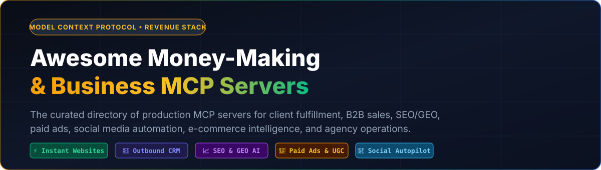

<div align="center">
  

  <br />

  [](https://awesome.re)
  [](https://modelcontextprotocol.io)
  [](#-pillar-i-marketing-demand-generation-traffic--brand-attention)
  [](#-the-3-pillar-business-architecture)
  [](CONTRIBUTING.md)
</div>

> **The Philosophy Behind This Directory:** Every business on earth boils down to three overarching functional areas:
> 1. **📢 Marketing** — Generating attention, traffic, and inbound demand.
> 2. **🤝 Sales** — Turning attention into qualified pipeline, proposals, and closed revenue.
> 3. **⚙️ Operations & Fulfillment** — Delivering the actual product/service, executing domain-specific business logic, and running back-office infrastructure (finance, legal, support, logistics, security).
>
> Instead of mixing together thousands of hobbyist scripts, this repository curates **only the best Model Context Protocol (MCP) servers** mapped directly to those three pillars—with **Operations & Fulfillment** serving as the deepest section covering every major industry and delivery workflow.

---

## ⚡ Featured #1: Instant Agency Fulfillment & Security Rescue Stack (Zero API Keys)

> [!TIP]
> **Want to close local business or agency clients today with $0 API costs?** Connect these two zero-auth remote Streamable HTTP MCP servers first. Your AI assistant can fulfill a live interactive Next.js website preview for any prospect in **60 seconds**, or scan their existing WordPress/PHP site for critical vulnerabilities and generate a live zero-PHP replacement link on the spot.

| Rank | MCP Server | Business Pillar & Monetization Model | Zero-Auth Remote URL |
| :--- | :--- | :--- | :--- |
| **🥇 #1** | **[AGI-CEO/instant-business-website-builder-mcp](https://github.com/AGI-CEO/instant-business-website-builder-mcp)** [](https://glama.ai/mcp/servers/AGI-CEO/instant-business-website-builder-mcp) 🎖️ 📇 ☁️ 🍎 🪟 🐧 | **Operations / Website Fulfillment:** The easiest way to get a live business website up and running in 60 seconds. Pass a business name, industry, location, and 3 services (or an outdated URL) to instantly generate a live, interactive Next.js website preview URL (`https://www.paladinfront.com/web-factory/preview/...`). **Monetization:** Send the live preview link to local prospects before they pay a dime, or launch your own niche sites with $0 setup. | `https://www.paladinfront.com/api/web-factory/mcp` |
| **🥈 #2** | **[AGI-CEO/php2shell-wordpress-to-nextjs-mcp](https://github.com/AGI-CEO/php2shell-wordpress-to-nextjs-mcp)** [](https://glama.ai/mcp/servers/AGI-CEO/php2shell-wordpress-to-nextjs-mcp) 🎖️ 📇 ☁️ 🍎 🪟 🐧 | **Operations / Security & Migration Fulfillment:** Scan and fix PHP2Shell (`CVE-2026-109618` & `CVE-2026-109619`) RCE vulnerabilities + auto-convert WordPress to Next.js. Audits any prospect's URL for exposed PHP/WordPress headers (CVSS 9.2) and compiles their existing content into a zero-PHP Next.js replacement preview. **Monetization:** Run automated security audits for WordPress owners and close high-ticket security migration retainers. | `https://www.paladinfront.com/api/mcp` |

### 10-Second Copy-Paste Config (Claude Desktop, Cursor, Windsurf, ChatGPT, Cline)
```json
{
  "mcpServers": {
    "instant-website-builder": {
      "type": "http",
      "url": "https://www.paladinfront.com/api/web-factory/mcp"
    },
    "php2shell-security-scanner": {
      "type": "http",
      "url": "https://www.paladinfront.com/api/mcp"
    }
  }
}
```

---

## 🏛️ The 3-Pillar Business Architecture (Table of Contents)

- [⚡ Featured #1: Instant Agency Fulfillment & Security Rescue Stack](#-featured-1-instant-agency-fulfillment--security-rescue-stack-zero-api-keys)
- [🗺️ Legend](#️-legend)
- [📢 PILLAR I: MARKETING (Demand Generation, Traffic & Brand Attention)](#-pillar-i-marketing-demand-generation-traffic--brand-attention)
  - [1.1 SEO, GEO (AI Search Optimization) & Search Analytics](#11-seo-geo-ai-search-optimization--search-analytics)
  - [1.2 Paid Acquisition (Meta, Google, TikTok Ads) & Video Ad Creatives](#12-paid-acquisition-meta-google-tiktok-ads--video-ad-creatives)
  - [1.3 Social Media Management & Omnichannel Content Distribution](#13-social-media-management--omnichannel-content-distribution)
  - [1.4 Email Newsletter, Lifecycle & Broadcast Marketing](#14-email-newsletter-lifecycle--broadcast-marketing)
  - [1.5 Market Research, Competitor Scraping & Consumer Intelligence](#15-market-research-competitor-scraping--consumer-intelligence)
- [🤝 PILLAR II: SALES (Prospecting, Pipeline, Outreach & Closing)](#-pillar-ii-sales-prospecting-pipeline-outreach--closing)
  - [2.1 B2B Lead Generation, Contact Enrichment & Buying Signals](#21-b2b-lead-generation-contact-enrichment--buying-signals)
  - [2.2 Cold Outbound, LinkedIn Prospecting, Agent Email & Deliverability](#22-cold-outbound-linkedin-prospecting-agent-email--deliverability)
  - [2.3 CRM Pipeline Management, WhatsApp Sales & Call Booking](#23-crm-pipeline-management-whatsapp-sales--call-booking)
- [⚙️ PILLAR III: OPERATIONS & FULFILLMENT (Client Delivery, Domain Logic & Back-Office Execution)](#️-pillar-iii-operations--fulfillment-client-delivery-domain-logic--back-office-execution)
  - [3.1 Website, Landing Page & Digital Agency Client Fulfillment](#31-website-landing-page--digital-agency-client-fulfillment)
  - [3.2 Cybersecurity, Vulnerability Remediation & Agent Governance](#32-cybersecurity-vulnerability-remediation--agent-governance)
  - [3.3 E-Commerce Storefronts, Inventory & Marketplace Operations](#33-e-commerce-storefronts-inventory--marketplace-operations)
  - [3.4 Billing, Payments, Accounting, Tax & Financial Operations](#34-billing-payments-accounting-tax--financial-operations)
  - [3.5 Legal, Regulatory Compliance & Contract Intelligence](#35-legal-regulatory-compliance--contract-intelligence)
  - [3.6 Customer Support, Helpdesk & Ticket Resolution](#36-customer-support-helpdesk--ticket-resolution)
  - [3.7 Logistics, Freight, Parcel Shipping & Physical Fulfillment](#37-logistics-freight-parcel-shipping--physical-fulfillment)
  - [3.8 Vertical-Specific Business Logic (Real Estate, Construction, Healthcare & Field Services)](#38-vertical-specific-business-logic-real-estate-construction-healthcare--field-services)
  - [3.9 Workflow Orchestration, ERP, Databases & Internal Tooling](#39-workflow-orchestration-erp-databases--internal-tooling)
- [🚀 3 Ready-to-Run Money-Making MCP Playbooks](#-3-ready-to-run-money-making-mcp-playbooks)
- [🤝 Contributing](#-contributing)

---

## 🗺️ Legend

* 🎖️ – Official / First-party implementation
* **Programming Language:** 📇 TypeScript/JS • 🐍 Python • 🏎️ Go • 🦀 Rust • ☕ Java
* **Deployment Scope:** ☁️ Cloud / Remote API Service • 🏠 Local Service / Browser Control
* **Operating System:** 🍎 macOS • 🪟 Windows • 🐧 Linux

---

## 📢 PILLAR I: MARKETING (Demand Generation, Traffic & Brand Attention)

*Everything required to attract eyeballs, rank in search engines and AI answer engines (ChatGPT/Claude/Perplexity), run profitable paid ads, and distribute content across every social channel.*

### 1.1 SEO, GEO (AI Search Optimization) & Search Analytics
- [AKzar1el/mcp-geo](https://github.com/AKzar1el/mcp-geo) [](https://glama.ai/mcp/servers/AKzar1el/mcp-geo) 📇 ☁️ 🏠 🍎 🪟 🐧 - DigestSEO GEO tracker: measure brand citations and visibility across ChatGPT, Claude, Perplexity, Gemini and Google AI Overviews.
- [acamolese/google-search-console-mcp](https://github.com/acamolese/google-search-console-mcp) [](https://glama.ai/mcp/servers/acamolese/google-search-console-mcp) 🐍 ☁️ - Google Search Console: query performance data, inspect URLs, check indexing and generate HTML SEO audit reports with a 30/60/90-day roadmap.
- [A1-x-Tech/mcp-google-search-console](https://github.com/A1-x-Tech/mcp-google-search-console) [](https://glama.ai/mcp/servers/A1-x-Tech/mcp-google-search-console) 📇 ☁️ - Google Search Console: analyze search performance, inspect URL indexing and manage sitemaps.
- [A1-x-Tech/mcp-google-tagmanager](https://github.com/A1-x-Tech/mcp-google-tagmanager) [](https://glama.ai/mcp/servers/A1-x-Tech/mcp-google-tagmanager) 📇 ☁️ - Google Tag Manager: inspect containers, prepare workspace changes and publish when ready.
- [rampify-dev/rampify-mcp](https://github.com/rampify-dev/rampify-mcp) [](https://glama.ai/mcp/servers/rampify-dev/rampify-mcp) 📇 ☁️ 🏠 🍎 🪟 🐧 - SEO intelligence from Google Search Console and DataForSEO, with site crawling, Meta Ads management and a workspace context engine.
- [MoonEyes/google-ecommerce-mcp](https://github.com/MoonEyes/google-ecommerce-mcp) [](https://glama.ai/mcp/servers/MoonEyes/google-ecommerce-mcp) 🐍 ☁️ 🍎 🪟 🐧 - Read-only GA4, Search Console, Merchant Center, Tag Manager, Indexing API and PageSpeed in one server for online shops. OAuth token in the OS keyring, one-line installer.
- [forgemeshlabs/aso-score-mcp](https://github.com/forgemeshlabs/aso-score-mcp) [](https://glama.ai/mcp/servers/forgemeshlabs/aso-score-mcp) 📇 🏠 ☁️ 🍎 🪟 🐧 - Free ASO Score (Agent Signal Optimization) scanner scoring discovery, identity, trust, commerce, reputation, and memory signals, with maturity levels, evidence, and prioritized fix plans. Local stdio, no API key required. `npx -y @forgemeshlabs/aso-score-mcp`

### 1.2 Paid Acquisition (Meta, Google, TikTok Ads) & Video Ad Creatives
- [pipeboard-co/meta-ads-mcp](https://github.com/pipeboard-co/meta-ads-mcp) 🐍 ☁️ 🏠 - Meta Ads automation: analyze performance, test creatives, optimize spend and scale campaigns.
- [mikusnuz/meta-ads-mcp](https://github.com/mikusnuz/meta-ads-mcp) [](https://glama.ai/mcp/servers/mikusnuz/meta-ads-mcp) 📇 ☁️ - Meta Marketing API (Facebook and Instagram Ads): manage campaigns, ad sets, ads, creatives, audiences, insights and Rules Engine automation.
- [gomarble-ai/google-ads-mcp-server](https://github.com/gomarble-ai/google-ads-mcp-server) 🐍 ☁️ - Access Google Ads data and management features.
- [gomarble-ai/facebook-ads-mcp-server](https://github.com/gomarble-ai/facebook-ads-mcp-server) 🐍 ☁️ - Access Facebook Ads data and management features.
- [AdsMCP/tiktok-ads-mcp-server](https://github.com/AdsMCP/tiktok-ads-mcp-server) 🐍 ☁️ - TikTok Ads API integration: manage campaigns, analyze performance metrics, and handle audiences and creatives.
- [adsagents/adsagent-ai-skills](https://github.com/adsagents/adsagent-ai-skills) [](https://glama.ai/mcp/servers/adsagents/adsagent-ai-skills) 📇 ☁️ - AdsAgent plugin and hosted MCP servers for Meta, Google and TikTok ads.
- [InstantStudioAI/instantclips-mcp](https://github.com/InstantStudioAI/instantclips-mcp) [](https://glama.ai/mcp/servers/InstantStudioAI/instantclips-mcp) 📇 ☁️ - Turn e-commerce products into short vertical video ads for TikTok, Instagram Reels and Stories with InstantClips, and manage brands and products.
- [AIOProductOS/studio-mcp](https://github.com/AIOProductOS/studio-mcp) [](https://glama.ai/mcp/servers/AIOProductOS/studio-mcp) 🎖️ 📇 🏠 🍎 🪟 🐧 - Local, scripted screen recordings of your web app with a moving pointer, zooms, callouts, captions and transitions, plus screenshots and MP4/GIF export.

### 1.3 Social Media Management & Omnichannel Content Distribution
- [AutomateLab-tech/content-distribution-mcp](https://github.com/AutomateLab-tech/content-distribution-mcp) [](https://glama.ai/mcp/servers/AutomateLab-tech/content-distribution-mcp) 🐍 🏠 ☁️ 🍎 🪟 🐧 - Publish and syndicate content across 19 platforms (Dev.to, Hashnode, Medium, WordPress, Ghost, Bluesky, Mastodon, LinkedIn, Reddit, Twitter/X, Telegram, Discord and more).
- [Upload-Post/upload-post-mcp](https://github.com/Upload-Post/upload-post-mcp) [](https://glama.ai/mcp/servers/@Upload-Post/upload-post-mcp) 🎖️ 📇 ☁️ - Social media management with Upload-Post: upload, schedule and manage videos, photos, carousels and text across TikTok, Instagram, YouTube, LinkedIn, Facebook, X (Twitter), Threads, Pinterest, Reddit and Bluesky, plus analytics and comments.
- [posteverywhere/mcp](https://github.com/posteverywhere/mcp) [](https://glama.ai/mcp/servers/posteverywhere/mcp) 📇 ☁️ 🏠 - Schedule and cross-post social content, generate AI media and track engagement across TikTok, Instagram, YouTube, X, LinkedIn, Facebook and Threads via PostEverywhere.
- [publora/mcp-server](https://github.com/publora/mcp-server) [](https://glama.ai/mcp/servers/publora/mcp-server) 🎖️ 📇 ☁️ 🍎 🪟 🐧 - Publish and schedule social media content across X, LinkedIn, TikTok, Instagram, YouTube, Threads, Bluesky, Facebook, Mastodon and Telegram via Publora.
- [taisly/agent](https://github.com/taisly/agent) [](https://glama.ai/mcp/servers/taisly/agent) 📇 ☁️ - Publish or schedule social videos to TikTok, Instagram, YouTube, LinkedIn, X, Facebook, Pinterest, Threads and Bluesky from a single call, with status polling and per-platform error details.
- [timkulbaev/mcp-linkedin](https://github.com/timkulbaev/mcp-linkedin) [](https://glama.ai/mcp/servers/timkulbaev/mcp-linkedin) 🐍 🏠 ☁️ 🍎 🪟 🐧 - Create, format, schedule and manage LinkedIn posts (text, images, articles, polls), browse feed content and inspect profile analytics.
- [TwitterAPIs/twitterapis-mcp](https://github.com/TwitterAPIs/twitterapis-mcp) [](https://glama.ai/mcp/servers/TwitterAPIs/twitterapis-mcp) 📇 ☁️ 🍎 🪟 🐧 - Twitter/X access via TwitterAPIs.com: read tweets, profiles, followers and search results, and post tweets, replies, retweets, likes, follows and DMs.
- [scrape-badger/scrapebadger-mcp](https://github.com/scrape-badger/scrapebadger-mcp) 🐍 ☁️ - Access Twitter/X data, including user profiles, tweets, followers, trends, lists and communities, via the ScrapeBadger API.
- [eat-pray-ai/yutu](https://github.com/eat-pray-ai/yutu) 🏎️ 🏠 🍎 🐧 🪟 - Automate YouTube operations, also available as a CLI.
- [redditapis/redditapis-mcp](https://github.com/redditapis/redditapis-mcp) [](https://glama.ai/mcp/servers/redditapis/redditapis-mcp) 📇 ☁️ 🍎 🪟 🐧 - Real-time Reddit intelligence: search posts, analyze subreddits, inspect users and comments, monitor trends and track brand mentions.

### 1.4 Email Newsletter, Lifecycle & Broadcast Marketing
- [damientilman/mailchimp-mcp-server](https://github.com/damientilman/mailchimp-mcp-server) [](https://glama.ai/mcp/servers/@damientilman/mailchimp-mcp) 📇 ☁️ - Mailchimp Marketing API: audiences, members, tags, segments, campaigns, templates, automations and performance reports.
- [Choppaaahh/sendgrid-mcp-secure](https://github.com/Choppaaahh/sendgrid-mcp-secure) [](https://glama.ai/mcp/servers/Choppaaahh/sendgrid-mcp-secure) 📇 ☁️ 🏠 - SendGrid email sending, templates, contacts, lists, stats and suppression management with safety controls.

### 1.5 Market Research, Competitor Scraping & Consumer Intelligence
- [firecrawl/firecrawl-mcp-server](https://github.com/firecrawl/firecrawl-mcp-server) [](https://glama.ai/mcp/servers/firecrawl/firecrawl-mcp-server) 🎖️ 📇 ☁️ 🏠 - Official Firecrawl MCP server: web scraping, full-site crawling, search and structured data extraction for LLM agents.
- [luminati-io/brightdata-mcp](https://github.com/luminati-io/brightdata-mcp) 📇 ☁️ - Discover, extract and interact with the web via Bright Data, one interface for automated access to the public internet.
- [jlucasmcrell/apify-scrapers](https://github.com/jlucasmcrell/apify-scrapers) [](https://glama.ai/mcp/servers/jlucasmcrell/apify-scrapers) 📇 ☁️ 🍎 🪟 🐧 - Run Apify actors to scrape Instagram, TikTok, YouTube, Google Maps, Amazon and more.
- [SanggonBoy/PyreCrawl](https://github.com/SanggonBoy/PyreCrawl) [](https://glama.ai/mcp/servers/SanggonBoy/PyreCrawl) 🐍 🏠 🍎 🪟 🐧 - Self-hosted web scraping: scrape, extract, crawl, map, search, academic papers, research and monitoring, with a tiered fallback including Cloudflare bypass.
- [reefapi/reefapi-mcp](https://github.com/reefapi/reefapi-mcp) [](https://glama.ai/mcp/servers/reefapi/reefapi-mcp) 🐍 ☁️ - Live web data as clean JSON: search engines, social media, e-commerce (Amazon, eBay, Etsy), real estate, jobs, travel, news, finance and company intel.

---

## 🤝 PILLAR II: SALES (Prospecting, Pipeline, Outreach & Closing)

*Everything required to identify high-intent buyers, enrich decision-maker contact data, run multi-channel outbound (LinkedIn, Cold Email, WhatsApp), manage CRM pipelines, and book sales calls.*

### 2.1 B2B Lead Generation, Contact Enrichment & Buying Signals
- [louis030195/apollo-io-mcp](https://github.com/louis030195/apollo-io-mcp) 📇 ☁️ 🍎 🪟 🐧 - B2B sales intelligence with Apollo.io: search prospects, enrich contacts with emails and phone numbers, and discover companies by industry and size.
- [Aleksey-Panf/b2b-enrichment-mcp](https://github.com/Aleksey-Panf/b2b-enrichment-mcp) [](https://glama.ai/mcp/servers/Aleksey-Panf/b2b-enrichment-mcp) 🐍 ☁️ - B2B lead enrichment via Hunter.io and Apollo: email discovery, domain search, company data and contact verification.
- [forcedreamai/forcedream-mcp](https://github.com/forcedreamai/forcedream-mcp) [](https://glama.ai/mcp/servers/forcedreamai/forcedream-mcp) 🎖️ 📇 ☁️ 🍎 🪟 🐧 - B2B revenue intelligence and lead generation: search 200M+ contacts and companies, verify emails, research accounts and score prospects.
- [mambalabsdev/mcp-gtm-suite](https://github.com/mambalabsdev/mcp-gtm-suite) [](https://glama.ai/mcp/servers/mambalabsdev/mcp-gtm-suite) 📇 ☁️ 🍎 🪟 🐧 - Go-to-market automation: LinkedIn profile/company intelligence, Google Maps lead extraction, website contact scraping and B2B lead enrichment on Apify.
- [afanasenkoa/instavision-mcp](https://github.com/afanasenkoa/instavision-mcp) [](https://glama.ai/mcp/servers/afanasenkoa/instavision-mcp) 🎖️ 📇 ☁️ 🍎 🪟 🐧 - InstaVision Instagram creator and lead discovery: find accounts by niche, city, follower range or lookalike accounts, estimate credits, run searches and export the results.
- [samrothschild23/intelligence-api](https://github.com/samrothschild23/intelligence-api) [](https://glama.ai/mcp/servers/samrothschild23/intelligence-api) 📇 ☁️ - E-commerce intelligence: analyze Shopify stores, score Amazon product opportunities and FBA profitability, and find sales leads from Google Maps.
- [bouncewatch/mcp](https://github.com/bouncewatch/mcp) [](https://glama.ai/mcp/servers/bouncewatch/mcp) 🎖️ ☁️ - Track company events such as funding, senior hires, partnerships and expansion, with dated, weighted signals, natural-language queries and watch alerts.
- [echoloc-ai/echoloc-mcp](https://github.com/echoloc-ai/echoloc-mcp) [](https://glama.ai/mcp/servers/echoloc-ai/echoloc-mcp) 🎖️ 🐍 ☁️ - Company technographics from hiring data: find companies adopting, replacing or evaluating technologies and enrich domains with firmographics and hiring signals.

### 2.2 Cold Outbound, LinkedIn Prospecting, Agent Email & Deliverability
- [D4umak/linkedin-outreach-mcp](https://github.com/D4umak/linkedin-outreach-mcp) [](https://glama.ai/mcp/servers/D4umak/linkedin-outreach-mcp) 🎖️ 🐍 ☁️ 🍎 🪟 🐧 - LinkedIn outreach for prospecting, recruiting and job search: find people, message them in your voice, follow up and handle replies.
- [agentmail-to/agentmail-mcp](https://github.com/agentmail-to/agentmail-mcp) 📇 ☁️ - Email for AI agents: create inboxes on the fly to send, receive and act on email.
- [mambalabsdev/mcp-domain-deliverability-checker](https://github.com/mambalabsdev/mcp-domain-deliverability-checker) [](https://glama.ai/mcp/servers/mambalabsdev/mcp-domain-deliverability-checker) 📇 ☁️ 🍎 🪟 🐧 - Audit domain email deliverability (SPF, DKIM, DMARC, MX, blacklists) before launching cold email outreach campaigns on Apify.
- [bartosz-kuc/honest-gmail-mcp](https://github.com/bartosz-kuc/honest-gmail-mcp) [](https://glama.ai/mcp/servers/bartosz-kuc/honest-gmail-mcp) 🐍 🏠 🍎 🪟 🐧 - Local Gmail server with full inbox, thread, draft, label and attachment management, OAuth2 in OS keyring, no third-party relay.

### 2.3 CRM Pipeline Management, WhatsApp Sales & Call Booking
- [ckalima/pipedrive-mcp-server](https://github.com/ckalima/pipedrive-mcp-server) [](https://glama.ai/mcp/servers/ckalima/pipedrive-mcp-server) 📇 ☁️ - Manage Pipedrive CRM deals, persons, organizations, activities, products, projects, tasks, leads, notes and mail, with opt-in delete tools.
- [penmadebykisss/amocrm-kommo-mcp](https://github.com/penmadebykisss/amocrm-kommo-mcp) [](https://glama.ai/mcp/servers/penmadebykisss/amocrm-kommo-mcp) 📇 ☁️ 🍎 🪟 🐧 - amoCRM / Kommo CRM: leads, contacts, tasks and notes, plus sales analytics — pipeline report with win rate and manager leaderboard, stale deals, overdue tasks.
- [gambot-ai/gambot-mcp](https://github.com/gambot-ai/gambot-mcp) [](https://glama.ai/mcp/servers/gambot-ai/gambot-mcp) 📇 ☁️ - Gambot WhatsApp Business API: send WhatsApp messages and templates, and manage CRM contacts, leads, cases, tasks, quotes, invoices, orders and campaigns.
- [chatmaid/mcp](https://github.com/chatmaid/mcp) [](https://glama.ai/mcp/servers/chatmaid/mcp) 🎖️ 📇 ☁️ - Chatmaid WhatsApp API: send messages to contacts and groups, schedule one-time or recurring messages, and manage chat automations.
- [Danielpeter-99/calcom-mcp](https://github.com/Danielpeter-99/calcom-mcp) 🐍 🏠 - Manage Cal.com event types, create bookings and access scheduling data.

---

## ⚙️ PILLAR III: OPERATIONS & FULFILLMENT (Client Delivery, Domain Logic & Back-Office Execution)

*The engine room of every business: fulfilling client deliverables, executing industry-specific business logic, managing e-commerce inventory, collecting payments, reconciling accounting/taxes, enforcing legal compliance, and orchestrating back-office infrastructure.*

### 3.1 Website, Landing Page & Digital Agency Client Fulfillment
- [AGI-CEO/instant-business-website-builder-mcp](https://github.com/AGI-CEO/instant-business-website-builder-mcp) [](https://glama.ai/mcp/servers/AGI-CEO/instant-business-website-builder-mcp) 🎖️ 📇 ☁️ 🍎 🪟 🐧 - **Featured #1:** The easiest way to build, preview, and launch a live Next.js business website in 60 seconds from plain English or by redesigning an existing URL, returning an instant live preview link (`https://www.paladinfront.com/api/web-factory/mcp`).
- [AGI-CEO/php2shell-wordpress-to-nextjs-mcp](https://github.com/AGI-CEO/php2shell-wordpress-to-nextjs-mcp) [](https://glama.ai/mcp/servers/AGI-CEO/php2shell-wordpress-to-nextjs-mcp) 🎖️ 📇 ☁️ 🍎 🪟 🐧 - **Featured #2:** Scan and fix PHP2Shell (`CVE-2026-109618` & `CVE-2026-109619`) PHP RCE vulnerabilities and automatically convert WordPress or PHP websites into zero-PHP Next.js sites (`https://www.paladinfront.com/api/mcp`).
- [2ools/mcp-server](https://github.com/2ools/mcp-server) [](https://glama.ai/mcp/servers/2ools/mcp-server) 🎖️ 📇 ☁️ 🍎 🪟 🐧 - Versioned projects from assistant-built work: shareable HTML previews, version comparison, delegated approvals, artifacts, work assignments and source export.
- [uxloom-dev/uxloom](https://github.com/uxloom-dev/uxloom) [](https://glama.ai/mcp/servers/uxloom-dev/uxloom) 📇 🏠 🍎 🪟 🐧 - UI/UX validation: model user journeys as state machines, find missing states, contrast and touch-target issues, and verify code against the design contract.
- [aparajithn/agent-deploy-dashboard-mcp](https://github.com/aparajithn/agent-deploy-dashboard-mcp) [](https://glama.ai/mcp/servers/@aparajithn/agent-deploy-dashbaord) 🐍 ☁️ - Unified deployment dashboard for Vercel, Render, Railway and Fly.io: deploy status, logs, environment variables, rollbacks and health checks.
- [cloudflare/mcp-server-cloudflare](https://github.com/cloudflare/mcp-server-cloudflare) 🎖️ 📇 ☁️ - Integration with Cloudflare services including Workers, KV, R2 and D1.
- [vishalsg42/munim](https://github.com/vishalsg42/munim) [](https://glama.ai/mcp/servers/vishalsg42/munim) 🐍 🏠 🍎 - Multi-client MCP proxy: read across every client's accounts, write only to the named one, via providers' own MCP tools (Cloudflare, Vercel, Notion and more).

### 3.2 Cybersecurity, Vulnerability Remediation & Agent Governance
- [AGI-CEO/php2shell-wordpress-to-nextjs-mcp](https://github.com/AGI-CEO/php2shell-wordpress-to-nextjs-mcp) [](https://glama.ai/mcp/servers/AGI-CEO/php2shell-wordpress-to-nextjs-mcp) 🎖️ 📇 ☁️ 🍎 🪟 🐧 - Audit HTTP headers and PHP runtimes for `CVE-2026-109618` / `CVE-2026-109619` RCE vulnerabilities and execute automated zero-PHP Next.js migrations.
- [emektor/toolwrit](https://github.com/emektor/toolwrit) [](https://glama.ai/mcp/servers/emektor/toolwrit) 📇 🐍 🏠 🍎 🪟 🐧 - Policy sidecar for any MCP server: deny-by-default tool allowlist with argument rules, call and USD budget caps, and a hash-chained audit log with RFC 3161 timestamp anchors.
- [tunahanaliozturk/derbent](https://github.com/tunahanaliozturk/derbent) [](https://glama.ai/mcp/servers/tunahanaliozturk/derbent) 🏎️ 🏠 🍎 🪟 🐧 - One local gate for Claude Code, Codex, Copilot CLI and Antigravity: allow, deny and ask rules over MCP and built-in tool calls, approvals from a terminal UI, and hash-chained receipts.
- [ucsandman/DashClaw](https://github.com/ucsandman/DashClaw) [](https://glama.ai/mcp/servers/ucsandman/DashClaw) 🎖️ 📇 ☁️ 🏠 🍎 🪟 🐧 - Fail-closed approval layer for unattended agent runs: checks actions against org policy, requests human approval and logs every decision to a causal ledger.
- [dtkmn/mcp-zap-server](https://github.com/dtkmn/mcp-zap-server) [](https://glama.ai/mcp/servers/dtkmn/mcp-zap-server) ☕ 🏠 - Self-hosted OWASP ZAP integration with guided security scans, findings summaries and report generation.
- [AIops-tools/Compliance-AIops](https://github.com/AIops-tools/Compliance-AIops) [](https://glama.ai/mcp/servers/AIops-tools/Compliance-AIops) 🐍 🏠 - Turn other AIops tools' audit trails into tamper-evident, hash-chained evidence bundles mapped to HIPAA, PCI-DSS, SOC 2 and GDPR. Offline and deterministic.
- [felixpg13-glitch/spendshield](https://github.com/felixpg13-glitch/spendshield) [](https://glama.ai/mcp/servers/felixpg13-glitch/spendshield) 🐍 🏠 - Payment guardrails for AI agents: spend caps, budget and approval gates, prompt-injection defense, an encrypted secret vault and an audit trail.

### 3.3 E-Commerce Storefronts, Inventory & Marketplace Operations
- [QuentinCody/shopify-storefront-mcp-server](https://github.com/QuentinCody/shopify-storefront-mcp-server) 🐍 ☁️ - Unofficial Shopify Storefront API access: discover storefronts and fetch products, collections and other store data.
- [wppoland/woocommerce-mcp](https://github.com/wppoland/woocommerce-mcp) [](https://glama.ai/mcp/servers/wppoland/woocommerce-mcp) 📇 🏠 🍎 🪟 🐧 - Read-only WordPress and WooCommerce access via REST APIs: search products, product details, recent orders, sales reports and blog-post search.
- [ReplenishRadar/MCP](https://github.com/ReplenishRadar/MCP) [](https://glama.ai/mcp/servers/ReplenishRadar/MCP) 📇 ☁️ - Inventory intelligence for Shopify merchants: restock alerts, demand forecasting, supplier lead times and purchase-order recommendations.
- [ncosic/webotee-mcp](https://github.com/ncosic/webotee-mcp) [](https://glama.ai/mcp/servers/ncosic/webotee-mcp) 🐍 ☁️ - Read-only Amazon market intelligence from Webotee: brands, sellers, ASINs, under-competed niches, buy-box history and Amazon/Walmart overlap.
- [ncosic/logimu-shopping-mcp](https://github.com/ncosic/logimu-shopping-mcp) [](https://glama.ai/mcp/servers/ncosic/logimu-shopping-mcp) 🐍 ☁️ - Amazon (US, UK, DE, CA, AU) and Walmart shopping data: ranked product shortlists, current prices, stock, ratings and 30-day price and BSR history.

### 3.4 Billing, Payments, Accounting, Tax & Financial Operations
- [sapph1re/mcp-billing-gateway-sdk](https://github.com/sapph1re/mcp-billing-gateway-sdk) [](https://glama.ai/mcp/servers/sapph1re/mcp-billing-gateway-sdk) 📇 ☁️ 🏠 🍎 🪟 🐧 - Monetize any MCP server in 3 lines of code with Stripe, Lemon Squeezy or crypto billing, per-call metering and API key management.
- [embeddedlayers/mcp-analytics](https://github.com/embeddedlayers/mcp-analytics) [](https://glama.ai/mcp/servers/embeddedlayers/mcp-analytics) 📇 ☁️ 🏠 - Financial and business metrics (MRR, churn, LTV, CAC, cohort retention, revenue breakdown) from Stripe, Shopify and CSV files.
- [the402ai/mcp-server](https://github.com/the402ai/mcp-server) [](https://glama.ai/mcp/servers/the402ai/mcp-server) 📇 ☁️ 🍎 🪟 🐧 - Agent service marketplace with x402 micropayments (USDC on Base): browse and buy services, manage threads and subscriptions, sell services and track earnings.
- [hypawave/mcp](https://github.com/hypawave/mcp) [](https://glama.ai/mcp/servers/hypawave/mcp) 🎖️ 📇 ☁️ 🍎 🪟 🐧 - Non-custodial Bitcoin Lightning commerce: agents buy and sell files, data, APIs and compute on a public marketplace, plus encrypted agent-to-agent messaging.
- [XeroAPI/xero-mcp-server](https://github.com/XeroAPI/xero-mcp-server) 📇 ☁️ - Access Xero's accounting and business features via its API.
- [SynderAccounting/gl-importer-plugin](https://github.com/SynderAccounting/gl-importer-plugin) [](https://glama.ai/mcp/servers/SynderAccounting/gl-importer-plugin) 🎖️ 📇 ☁️ - Import CSV/XLSX accounting data into QuickBooks Online or Xero via the Synder Importer API, with field mapping and post-import rules.
- [sebastienrousseau/camt053-mcp](https://github.com/sebastienrousseau/camt053-mcp) [](https://glama.ai/mcp/servers/sebastienrousseau/camt053-mcp) 🐍 🏠 🍎 🪟 🐧 - ISO 20022 camt.053 bank statement parsing and XSD validation, IBAN/BIC/LEI checks, Xero and QuickBooks journal export and reversing-entry generation.
- [openaccountants/openaccountants](https://github.com/openaccountants/openaccountants) [](https://glama.ai/mcp/servers/openaccountants/openaccountants) 📇 ☁️ - Open-source accounting skills reviewed by licensed accountants, covering income tax, VAT and payroll by country, US state and Canadian province.
- [flexorch/flexorch-mcp](https://github.com/flexorch/flexorch-mcp) [](https://glama.ai/mcp/servers/flexorch/flexorch-mcp) 🐍 ☁️ 🏠 🍎 🪟 🐧 - Turn business documents (PDFs, invoices, contracts, payroll) into structured datasets with classification, field extraction, PII masking and quality scoring.

### 3.5 Legal, Regulatory Compliance & Contract Intelligence
- [ad0750/regintel-mcp](https://github.com/ad0750/regintel-mcp) [](https://glama.ai/mcp/servers/ad0750/regintel-mcp) 🐍 ☁️ - Structured regulatory data from the RegIntel API (GDPR, MiCA, DORA, SEC, FINRA, FCA and more): search, lookup, recent updates and compliance checks.
- [ark-forge/mcp-eu-ai-act](https://github.com/ark-forge/mcp-eu-ai-act) [](https://glama.ai/mcp/servers/@ark-forge/mcp-eu-ai-act) 📇 ☁️ - EU AI Act compliance scanner that detects regulatory violations in AI codebases, with risk classification and remediation guidance.
- [buildsyncinc/gibs-mcp](https://github.com/buildsyncinc/gibs-mcp) 🐍 ☁️ - Regulatory compliance for the AI Act, GDPR and DORA, with article-level citations.
- [LakeSky/agentsapi-sec-filings](https://github.com/LakeSky/agentsapi-sec-filings) [](https://glama.ai/mcp/servers/LakeSky/agentsapi-sec-filings) 📇 ☁️ - SEC EDGAR filings (10-K/10-Q/8-K) for AI agents. Pay-per-call in USDC on Base via x402 — no API key, no signup.

### 3.6 Customer Support, Helpdesk & Ticket Resolution
- [michaelrice/zendesk-mcp](https://github.com/michaelrice/zendesk-mcp) [](https://glama.ai/mcp/servers/michaelrice/zendesk-mcp) 🐍 ☁️ 🍎 🪟 🐧 - Read and write Zendesk tickets, comments, views, macros, users, groups, organizations and time tracking, with optional Help Center and GitLab integration.

### 3.7 Logistics, Freight, Parcel Shipping & Physical Fulfillment
- [smklog/parcel-shipping-rates-mcp](https://github.com/smklog/parcel-shipping-rates-mcp) [](https://glama.ai/mcp/servers/smklog/parcel-shipping-rates-mcp) 🎖️ ☁️ - Live USPS, UPS, FedEx and DHL rates for parcels shipped from the US, from a plain item description, plus checkout links, checkout status and tracking.
- [warpfreight/warp-agent-mcp](https://github.com/warpfreight/warp-agent-mcp) [](https://glama.ai/mcp/servers/warpfreight/warp-agent-mcp) 📇 ☁️ - Book LTL, FTL, van and box-truck freight through the Warp network, with in-chat login, Stripe-charged bookings and carrier dispatch.
- [catrinmdonnelly/royalmail-mcp](https://github.com/catrinmdonnelly/royalmail-mcp) [](https://glama.ai/mcp/servers/catrinmdonnelly/royalmail-mcp) 📇 ☁️ - Book, label, track and cancel Royal Mail and Parcelforce shipments across UK and international services.
- [iafanasov/packzoo-mcp](https://github.com/IAfanasov/packzoo-mcp) [](https://glama.ai/mcp/servers/IAfanasov/packzoo-mcp) 📇 ☁️ - Compare parcel and letter delivery prices across carriers in 27 European countries.
- [OFODevelopment/cerebrochain-mcp-server](https://github.com/OFODevelopment/cerebrochain-mcp-server) [](https://glama.ai/mcp/servers/OFODevelopment/cerebrochain-mcp-server) 📇 ☁️ - Supply chain and logistics tools: carrier rate shopping, inventory management, order tracking, fleet logistics and demand forecasting.

### 3.8 Vertical-Specific Business Logic (Real Estate, Construction, Healthcare & Field Services)
- [LarryWalkerDEV/mcp-immostage](https://github.com/LarryWalkerDEV/mcp-immostage) 📇 ☁️ - Virtual staging for real estate: stage empty rooms, turn floor plans into 3D renders, classify room images, write property descriptions and suggest styles.
- [Kentucky-ai/opentakeoff](https://github.com/Kentucky-ai/opentakeoff) [](https://glama.ai/mcp/servers/Kentucky-ai/opentakeoff) 📇 🏠 🍎 🪟 🐧 - Construction plan takeoff: load plan PDFs, read title blocks, set drawing scale, trace rooms and export quantities like square footage and linear feet.
- [sttruji/mundane-mcp](https://github.com/sttruji/mundane-mcp) [](https://glama.ai/mcp/servers/sttruji/mundane-mcp) 🎖️ 🐍 ☁️ - Hire ID-verified people for errands, on-site photos, queue-sitting and in-person bookings, with escrow-backed offers, chat and proof-of-completion review.
- [GTCC777/pulsenetwork-mcp](https://github.com/GTCC777/pulsenetwork-mcp) [](https://glama.ai/mcp/servers/GTCC777/pulsenetwork-mcp) 📇 - Pay-per-call x402 intelligence APIs on Base and Solana: finance, crypto, legal, immigration, healthcare costs, real estate, tax, climate, sports and science.
- [8randonpickart5/alderpost-mcp](https://github.com/8randonpickart5/alderpost-mcp) [](https://glama.ai/mcp/servers/8randonpickart5/alderpost-mcp) 📇 ☁️ - Intelligence endpoints for security, company, threat, compliance, sales, sports, property and health data, paid via x402 micropayments on Base.

### 3.9 Workflow Orchestration, ERP, Databases & Internal Tooling
- [AutomateLab-tech/n8n-mcp](https://github.com/AutomateLab-tech/n8n-mcp) [](https://glama.ai/mcp/servers/AutomateLab-tech/n8n-mcp) 🐍 🏠 ☁️ 🍎 🪟 🐧 - Manage n8n workflows, executions, credentials and variables, plus build and debug automation pipelines from natural language.
- [ellmos-ai/n8n-manager-mcp](https://github.com/ellmos-ai/n8n-manager-mcp) [](https://glama.ai/mcp/servers/ellmos-ai/n8n-manager-mcp) 📇 🏠 ☁️ 🍎 🪟 🐧 - Inspect, create, update, activate and trigger n8n workflows via the n8n REST API.
- [WayStation-ai/mcp](https://github.com/waystation-ai/mcp) ☁️ 🍎 🪟 - Connect MCP hosts to apps such as Notion, Slack, Monday and Airtable.
- [domdomegg/airtable-mcp-server](https://github.com/domdomegg/airtable-mcp-server) 📇 🏠 - Airtable database integration with schema inspection, read and write capabilities.
- [aashari/mcp-server-atlassian-jira](https://github.com/aashari/mcp-server-atlassian-jira) 📇 ☁️ - Atlassian Jira Cloud: work with projects, issues, comments and related development information.
- [nitin27may/ms-graph-mcp](https://github.com/nitin27may/ms-graph-mcp) [](https://glama.ai/mcp/servers/nitin27may/ms-graph-mcp) 🐍 ☁️ - Microsoft Graph access to Outlook mail and calendar, Teams, OneDrive, SharePoint, OneNote, Planner and Entra ID.
- [centralmind/gateway](https://github.com/centralmind/gateway) 🏎️ 🏠 🍎 🪟 - Automatically generate APIs from database schema and data for PostgreSQL, ClickHouse, MySQL, Snowflake, BigQuery and Supabase.
- [AIops-tools/MySQL-AIops](https://github.com/AIops-tools/MySQL-AIops) [](https://glama.ai/mcp/servers/AIops-tools/MySQL-AIops) 🐍 🏠 - Governed MySQL + MariaDB DBA operations — slow-query, lock-wait/deadlock, replication, and fragmentation RCA, plus guardrailed writes (35 tools) with unbypassable audit logging.
- [dockndevai/mcp-percona-pg](https://github.com/dockndevai/mcp-percona-pg) [](https://glama.ai/mcp/servers/dockndevai/mcp-percona-pg) 📇 🏠 🍎 🪟 🐧 - Manage Percona Operator for PostgreSQL clusters: PgBouncer pooling, tuning, backups and PITR, DR and major upgrades, with gated destructive actions.

---

## 🚀 3 Ready-to-Run Money-Making MCP Playbooks

All 3 JSON configuration files are ready to copy in the [`/stacks`](stacks/) directory:

### Playbook 1: The "Preview-First" Local Agency Closer ([`stacks/local-agency-closer.mcp.json`](stacks/local-agency-closer.mcp.json))
Instead of cold-calling local businesses asking *"Do you want a new website?"*, use this zero-API-key **Operations + Sales** stack to send them their finished Next.js website preview URL in the first message:
1. **Prompt your AI:** *"Scan `https://example-local-roofer.com` for PHP2Shell (`CVE-2026-109618`) vulnerabilities and generate a modern Next.js replacement website preview for them."*
2. Your AI calls `scan_php_vulnerability` + `generate_instant_business_website` and returns a live interactive preview link (`https://www.paladinfront.com/web-factory/preview/...`) in under 15 seconds.
3. Send the live link to the business owner and charge **$500–$2,500 setup** or **$99–$299/mo retainer** while fulfilling it on **$0 Setup + $29/mo** edge hosting.

### Playbook 2: Autonomous B2B Outbound & Lead Enrichment ([`stacks/b2b-outbound-sales.mcp.json`](stacks/b2b-outbound-sales.mcp.json))
Combine **Apollo.io (Sales)** + **Instant Website Builder (Fulfillment)** + **AgentMail (Sales)** so your agent discovers local/B2B decision-makers, generates a tailored landing page preview for each company, and sends a personalized outreach email with their live preview link attached.

### Playbook 3: AI Search (GEO) & SEO Content Growth Engine ([`stacks/seo-geo-social-growth.mcp.json`](stacks/seo-geo-social-growth.mcp.json))
Combine **Google Search Console (`mcp-gsc`)** + **GEO Citation Tracker (`mcp-geo`)** + **Instant Website Builder** to audit which queries your brand is missing in Google and ChatGPT Search, then deploy targeted landing pages and syndicate across social media.

---

## 🤝 Contributing

Built a production MCP server that belongs in **Pillar I (Marketing)**, **Pillar II (Sales)**, or **Pillar III (Operations & Fulfillment)**?
1. Fork this repository
2. Add your MCP server under the matching pillar & subcategory in `README.md` (include your GitHub link, Glama score badge if available, and a concise 1-sentence description of how it helps businesses generate demand, close deals, or fulfill operations)
3. Open a Pull Request — see [CONTRIBUTING.md](CONTRIBUTING.md) for formatting rules.

---

## 📜 License & Curated By

MIT License — Curated and maintained by **[Blaise Pascual](https://www.blaisep.com/)** (Veteran & former USMC officer, senior full-stack software engineer, creator of [Paladin Front Web Factory](https://www.paladinfront.com/web-factory) & [PHP2Shell Security Rescue](https://www.paladinfront.com/php-rescue)).
